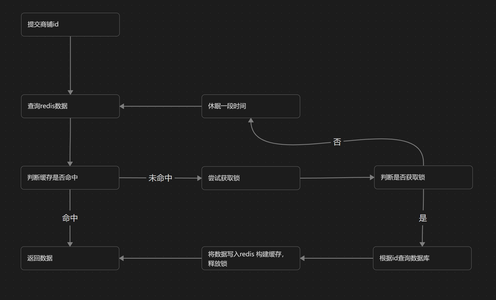
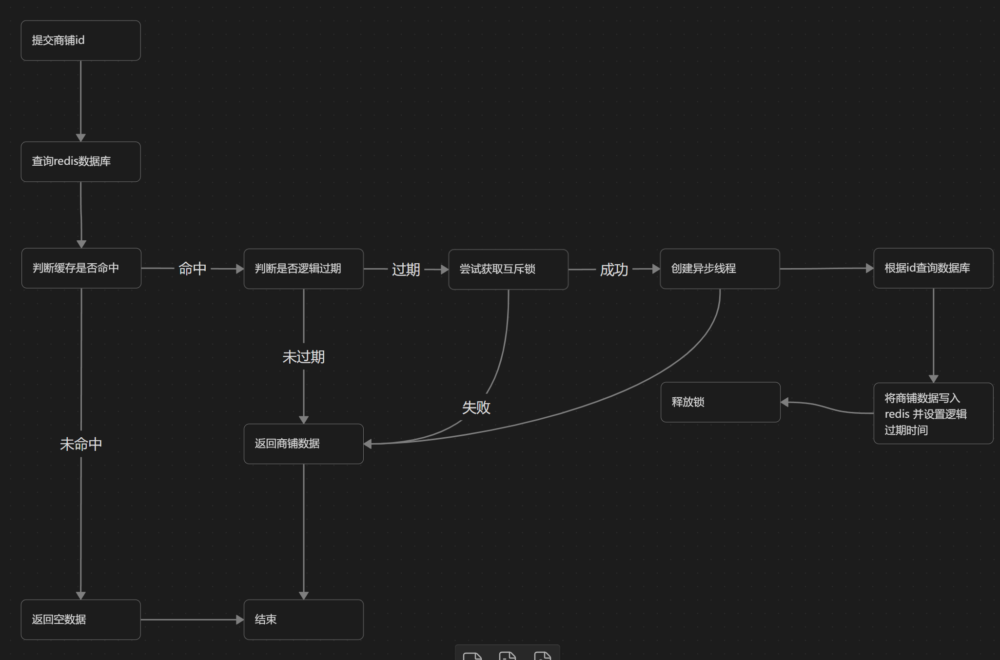

原先我们的业务由于没有缓存实现，每次查询数据只能查询数据库，这就导致查询速度慢，造成用户体验不佳，所以我们要增加缓存

# 模型与思路

！[缓存生效流程](./image/assets/缓存生效流程.webp)

我们的业务思路是，如果有缓存 则直接返回数据，没有就继续向下请求数据库获取数据，并向Redis中同样写入一份缓存，以便下次能够更快的查询

# 缓存更新策略
由于我们的缓存数据源来自于数据库，而数据库中的数据是会发生变化的美因此，当数据库中的数据发生变化，而缓存却没有同步，就会产生一致性问题
**方案**
Cache Aside Pattern 人工编码方式：缓存调用者在更新完数据库后再去更新缓存，也称之为双写方案

Read/Write Through Pattern : 由系统本身完成，数据库与缓存的问题交由系统本身去处理

Write Behind Caching Pattern ：调用者只操作缓存，其他线程去异步处理数据库，实现最终一致
 **内存淘汰**：完全依赖 Redis 内存不足时自动驱逐。一致性最差，维护成本为零。仅适用于极低一致性要求、且数据变更极少的场景（如店铺类型列表）。
    
	 
**超时剔除**：给缓存设 TTL，到期自动删除。一致性一般，维护成本低。这是项目中几乎所有缓存的**基础兜底手段**。
    
**主动更新**：写数据库时由代码主动操作缓存。一致性最好，但维护成本高。这是商户详情等核心数据采用的**主策略**。


针对不同的业务需求，我们采用不同的更新策略

在这里我们基于查询商户信息示例，商户需要经常性的更改店铺数据，所以可以采用主动更新+超时删除兜底的方案

为了避免发生多线程并发问题导致的业务漏洞，我们一般
**先操作数据库，再删除缓存**
确保用户随时有数据可查

## 方案实现

```java
@Override
public Result queryById(Long id) {
    String key = CACHE_SHOP_KEY + id;
    // 1.从redis查询商铺缓存
    String shopJson = stringRedisTemplate.opsForValue().get(key);
    // 2.判断是否存在
    if (StrUtil.isNotBlank(shopJson)) {
        // 3.存在，直接返回
        Shop shop = JSONUtil.toBean(shopJson, Shop.class);
        return Result.ok(shop);
    }
    // 4.不存在，根据id查询数据库
    Shop shop = getById(id);
    // 5.不存在，返回错误
    if (shop == null) {
        return Result.fail("店铺不存在！");
    }
    // 6.存在，写入redis
    stringRedisTemplate.opsForValue().set(key, JSONUtil.toJsonStr(shop), 30L, TimeUnit.MINUTES);
    // 7.返回
    return Result.ok(shop);
}
```

```java
@Override
@Transactional
public Result update(Shop shop) {
    Long id = shop.getId();
    if (id == null) {
        return Result.fail("店铺id不能为空");
    }
    // 1. 更新数据库
    updateById(shop);
    // 2. 删除缓存
    stringRedisTemplate.delete(CACHE_SHOP_KEY + id);
    return Result.ok();
}
```


# 缓存穿透

穿透是指客户端请求的数据在缓存中和数据库中都不存在，这样缓存永远不会生效，所有请求都会到数据库，造成数据库请求压力

我们采用缓存空对象的方式来解决，

**实现思路**
当客户端请求不存在的数据时，先在redis中查有没有缓存，如果没有则进一步查数据库，现在我们要避免redis一直没有数据的情况，即redis形同虚设 ，解决这个问题，我们保证redis有数据给客户端返回就好，即使是空数据 。
在数据库中查不到数据时，在redis中存入空数据，保证redis能正常发挥作用


# 缓存雪崩
雪崩是指在同一时间大量的缓存key同时失效或redis服务宕机，导致大量请求到达数据库 造成压力

**解决方案**
- 给不同的key添加不同的ttl 使其不会同时过期
- 利用redis集群提高服务可用性
- 给业务添加多层缓存

这里采用的是 ttl随机化来解决 即在原基础ttl上再随机一个时间 降低同时失效的概率 

# 缓存击穿

**单个热点 Key** 突然失效，瞬间大量并发请求同时去查数据库重建缓存，压垮数据库

**解决方案**
- 互斥锁
- 逻辑过期

## 互斥锁
利用redis 的SETEX 检测此时是否有线程占用 ，确保只有抢到锁的线程能够执行业务，
其他线程循环重试，直到上个线程结束业务
注意，抢到锁后需要二次检查redis 避免在抢锁这个极短过程中有复数个线程进入，并为key设置ttl 避免死锁



依照这个流程图，能确保同一时间只有一个线程能够执行业务
```java
public Shop queryWithMutex(Long id)  {

        String key = CACHE_SHOP_KEY + id;

        // 1、从redis中查询商铺缓存

        String shopJson = stringRedisTemplate.opsForValue().get("key");

        // 2、判断是否存在

        if (StrUtil.isNotBlank(shopJson)) {

            // 存在,直接返回

            return JSONUtil.toBean(shopJson, Shop.class);

        }

        //判断命中的值是否是空值

        if (shopJson != null) {

            //返回一个错误信息

            return null;

        }

        // 4.实现缓存重构

        //4.1 获取互斥锁

        String lockKey = "lock:shop:" + id;

        Shop shop = null;

        try {

            boolean isLock = tryLock(lockKey);

            // 4.2 判断否获取成功

            if(!isLock){

                //4.3 失败，则休眠重试

                Thread.sleep(50);

                return queryWithMutex(id);

            }

            //4.4 成功，根据id查询数据库

             shop = getById(id);

            // 5.不存在，返回错误

            if(shop == null){

                 //将空值写入redis

                stringRedisTemplate.opsForValue().set(key,"",CACHE_NULL_TTL,TimeUnit.MINUTES);

                //返回错误信息

                return null;

            }

            //6.写入redis

            stringRedisTemplate.opsForValue().set(key,JSONUtil.toJsonStr(shop),CACHE_NULL_TTL,TimeUnit.MINUTES);

  

        }catch (Exception e){

            throw new RuntimeException(e);

        }

        finally {

            //7.释放互斥锁

            unlock(lockKey);

        }

        return shop;

    }
```

## 逻辑过期

redis不设置物理过期 ttl 而在value中设置expireTime字段 查询时如果发现逻辑时间过期 当前线程直接返回旧数据 同时尝试抢锁开启独立线程异步重建缓存

逻辑过期依赖缓存中原本存在数据 如果没有会直接返回NULL 不会重建


重建完成之前，所有请求只会返回旧数据 造成短暂的数据不一致 

三个判断 
判断缓存是否命中
判断逻辑是否过期
判断是否获取到互斥锁

成功获取锁之后新开进程处理缓存重建

```java
private static final ExecutorService CACHE_REBUILD_EXECUTOR = Executors.newFixedThreadPool(10);

public Shop queryWithLogicalExpire( Long id ) {

    String key = CACHE_SHOP_KEY + id;

    // 1.从redis查询商铺缓存

    String json = stringRedisTemplate.opsForValue().get(key);

    // 2.判断是否存在

    if (StrUtil.isBlank(json)) {

        // 3.存在，直接返回

        return null;

    }

    // 4.命中，需要先把json反序列化为对象

    RedisData redisData = JSONUtil.toBean(json, RedisData.class);

    Shop shop = JSONUtil.toBean((JSONObject) redisData.getData(), Shop.class);

    LocalDateTime expireTime = redisData.getExpireTime();

    // 5.判断是否过期

    if(expireTime.isAfter(LocalDateTime.now())) {

        // 5.1.未过期，直接返回店铺信息

        return shop;

    }

    // 5.2.已过期，需要缓存重建

    // 6.缓存重建

    // 6.1.获取互斥锁

    String lockKey = LOCK_SHOP_KEY + id;

    boolean isLock = tryLock(lockKey);

    // 6.2.判断是否获取锁成功

    if (isLock){

        CACHE_REBUILD_EXECUTOR.submit( ()->{

  

            try{

                //重建缓存

                this.saveShop2Redis(id,20L);

            }catch (Exception e){

                throw new RuntimeException(e);

            }finally {

                unlock(lockKey);

            }

        });

    }

    // 6.4.返回过期的商铺信息

    return shop;

}
```


