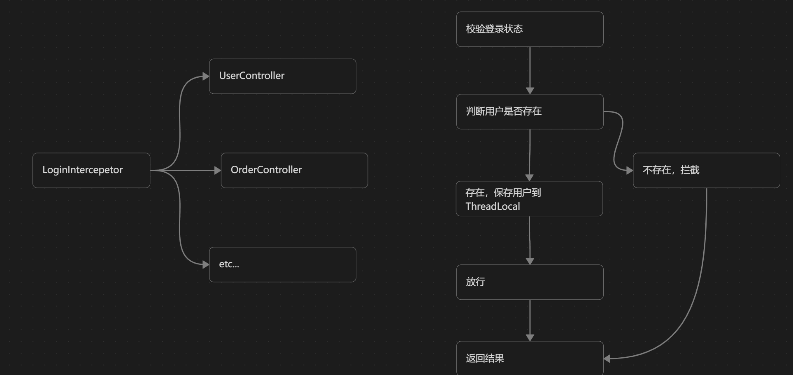

# Redis优化session认证登录

为什么我们要做优化，原本的Session 存储在Tomcat内存里 当我们的业务扩展之后，需要多个服务器构成集群后，那由于不同机器的数据是不共享的，想实现业务就需要存储多份相同数据，这极大的造成了内存资源的浪费


那为什么采用Redis ？ Redis独立于Tomcat的外部存储 能满足数据共享 内存级读写，能够支持数据持久化，支持主从集群 分片集群

## 登录成功时,Redis 存了什么

验证码校验通过后，服务端生成一个 UUID 作为 Token，并拼接成 Redis Key：`login:token:{token}`。用户信息（`UserDTO`，只含 id、昵称、头像）以 **Hash 结构**存入这个 Key，同时设置 TTL（如 30 分钟）。选择 Hash 而非 JSON String，是因为 Hash 可以单独更新某个字段，内存占用也更紧凑。

Token 返回给前端后，前端后续请求会在请求头 `authorization` 中携带它。服务端不再依赖 Cookie，凭证由前端显式管理。

## 为什么是两个拦截器 




可以看到拦截器仅仅是在需要用户登录的接口发挥作用，但如果用户没有在这些需要登录的接口，而只在不需要调用登录的部分浏览，那么这些请求根本不会触发拦截器，也就失去了他本来的作用 这样的业务就造成了一个很反直觉的问题：
用户明明持续在使用系统 Token却因为从未刷新而过期了


要解决这个问题，我们在LoginInterceptor 之前再加一个拦截器 RefreshTokenInterceptor 用于拦截所有请求，
作用是  尝试从token 查Redis ，查到就存入ThreadLocal 更新ttl 放行
查不到的话也放行

RefreshTokenInterceptor 不对token做校验，只负责刷新登录态续期，即使请求没带token或者token无效，都放行，把判断的权限放给LoginInterceptor


## ThreadLocal在整个流程的作用

ThreadLocal通过将数据信息存在thread对象中的成员变量，其在Tomcat中是每个线程之前天然独立的，从而在一定程度上规避了多线程数据请求的安全问题，也避免了在代码中反复传参造成的代码可读性差和较高的代码耦合性，具体来看，就是通过Userholder工具类来优化代码

```java
public class UserHolder {
    // 必须是 static final：所有线程共用同一把"钥匙"，各自开各自的"柜子"
    private static final ThreadLocal<UserDTO> tl = new ThreadLocal<>();

    public static void saveUser(UserDTO user) {
        tl.set(user);
    }

    public static UserDTO getUser() {
        return tl.get();
    }

    public static void removeUser() {
        tl.remove(); // 必须手动清理，防止线程池复用导致数据串线
    }
}
```


## 为什么用构造方法来实现RedisTemplete 


RefreshTokenInterceptor 代码如下

```java
private final StringRedisTemplate stringRedisTemplate;  
  
public RefreshTokenInterceptor(StringRedisTemplate stringRedisTemplate) {  
    this.stringRedisTemplate = stringRedisTemplate;  
}
```
`RefreshTokenInterceptor` 是**手动 `new` 出来的**，不是 Spring 容器管理的 Bean。因此它内部不能用 `@Autowired` 注入 `StringRedisTemplate`（注入会失效，运行时 NPE）。解决方案是在 `MvcConfig` 中（`MvcConfig` 本身是 Spring Bean）通过构造函数把 `StringRedisTemplate` 传进去。


```java
@Configuration  
public class MVCConfig implements WebMvcConfigurer {  
    @Resource  
    private StringRedisTemplate stringRedisTemplate;  
  
    //配置拦截器  
    @Override  
    public void addInterceptors(InterceptorRegistry registry) {  
        registry.addInterceptor(new LoginInterceptor())  
                .excludePathPatterns(  
                        "/user/code",  
                        "/user/login",  
                        "/shop/**",  
                        "/shop-type/**",  
                        "/upload/**",  
                        "/blog/hot",  
                        "/blog/search").order(1);  
        registry.addInterceptor(new RefreshTokenInterceptor(stringRedisTemplate)).order(0);  
    }  
}
```
